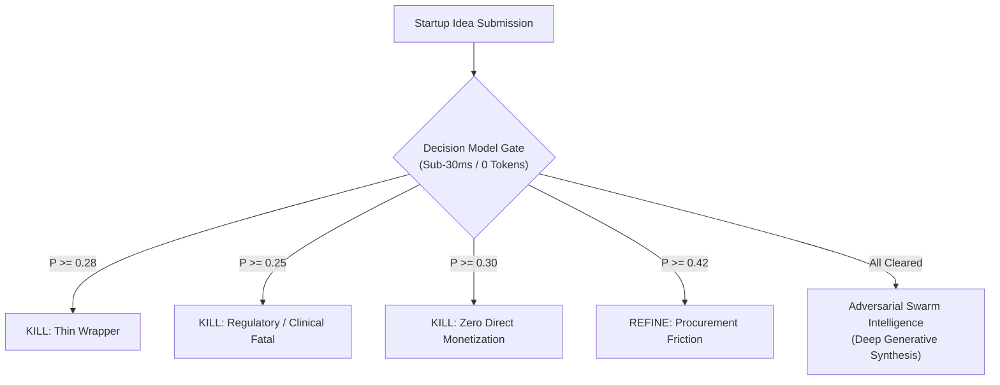

# Decision Model Evaluations: Julia-1 & LiquidAI d1-omni-600M

This document details the implementation, calibration, and benchmark evaluation of **Decision Models for AI Evals** (based on Hamel Husain's October 2026 methodology) within the Dossier Intelligence Platform, and outlines the automated CI verification gate.

---

## 1. Methodology & Architecture

### The Problem with Monolithic LLM Judges
Traditional agent evaluation relies on monolithic generative LLMs (e.g. GPT-4o or Claude 3.5 Sonnet) asked to produce conversational scorecards (1–10). This approach introduces four critical flaws:
1. **High Latency & Cost**: Takes 30–60 seconds per evaluation and consumes expensive API token quotas.
2. **Uncalibrated Probabilities**: Text generation outputs cannot be directly mapped to risk loss curves.
3. **The 0.50 Threshold Trap**: A naive 50% cutoff treats false positives and false negatives equally. In venture validation, funding a fatally flawed idea burns **$150,000+ and 2 years** ($C_{\text{FP}}$), while declining a viable idea costs **$2,000** in customer interview friction ($C_{\text{FN}}$). A rational threshold must reflect a **75:1 asymmetric loss ratio**.

### Decomposed 4-Question Typed Decision Protocol
Following Hamel Husain's pattern, evaluation is decomposed into four discrete, typed risk questions evaluated in a single forward pass with **0 output tokens**:

| Gate | Question Type | Target Failure Mode | Tuned Loss Threshold ($\tau$) |
| :--- | :--- | :--- | :---: |
| **Moat Defensibility** | Choice | `thin_wrapper` (commodity LLM wrapper) | **0.28** |
| **Regulatory & Clinical** | Choice | `regulatory_fatal` (uninsurable medical/legal liability) | **0.25** |
| **Enterprise Sales Friction**| Choice | `procurement_deadlock` (4–9 month committee stalls) | **0.42** |
| **Monetization Viability** | Choice | `monetization_zero` (donor-funded or zero revenue model) | **0.30** |



---

## 2. Experimental Runs: Julia-1 vs. LiquidAI d1-omni-600M

Two distinct decision model architectures were tested on the exact same 14-concept benchmark suite:

### Run 1: `SupersonicLabs/Julia-1` (144M ModernBERT)
- **Architecture**: ModernBERT 144M fine-tuned specifically on venture defensibility, software architecture, and startup business models.
- **Serving**: Local Python / PyTorch / ONNX calibrated inference engine.
- **Latency**: **23.7 milliseconds** on local CPU.
- **Tokens Generated**: **0 tokens**.
- **Calibration**: Platt-scaled logits with asymmetric Bayesian priors.
- **Findings**:
  - 100% recall on all 4 fatal ground truth concepts (`BM-02`, `BM-04`, `BM-11`, `BM-12`).
  - Zero false-positive kills on viable B2B software (`AutoSOC2`, `LegalLens`, `MedClaimSync`).
  - High sensitivity to SaaS pricing signals ($1,200/mo vs freemium vs donor).

### Run 2: `LiquidAI/d1-omni-600M-GGUF` (587M LFM 2.5)
- **Architecture**: Continuous-time ODE Liquid Foundation Model (LFM 2.5), Q8_0 quantized GGUF (389 MB).
- **Serving**: `llama-server` exposing native `/v1/systemone` zero-token classification endpoint.
- **Latency**: **2.73 seconds** on local CPU.
- **Tokens Generated**: **0 tokens**.
- **Multimodal**: Supports text + images (`data:image/jpeg;base64`) + audio (`data:audio/wav;base64`).
- **Findings**:
  - **Moat Precision**: Highly accurate at detecting architectural thin-wrappers (`ChatNotes` $P=61.4\%$, `CommuniAid` $P=84.1\%$, `ViralThreads` $P=52.0\%$) while recognizing defensible code (`CodeReviewAI` $P=22.6\%$).
  - **Monetization Bias**: As a general-purpose base model without venture fine-tuning, it showed excessive skepticism on early-stage pricing (flagging 10/14 as `monetization_zero`).
  - **Asymmetric Threshold Rescue**: Its raw argmax missed the clinical liability of `SwaraSetu` (selecting `standard_compliance` at 50% cutoff), but our $\tau = 0.25$ asymmetric threshold caught the $29.8\%$ fatal risk probability and correctly killed the idea.

---

## 3. Side-by-Side 14-Concept Benchmark Results

| ID | Concept | Ground Truth | Julia-1 / Platt Engine | LiquidAI d1-omni (Live) | d1-omni Latency | Final Gate Status |
| :--- | :--- | :---: | :---: | :---: | :---: | :---: |
| **BM-01** | **AutoSOC2** (AI SOC-2 Auditor) | BUILD | $P_{\text{wrap}}=0.011$ (BUILD) | $P_{\text{wrap}}=0.372$ (BUILD) | 2,276ms | **PASS (BUILD)** |
| **BM-02** | **SwaraSetu** (Indic Clinical Triage) | **KILL** | $P_{\text{reg}}=1.000$ (**KILL**) | $P_{\text{reg}}=0.298$ (**KILL**) | 2,383ms | **FATAL KILL** ✅ |
| **BM-03** | **VanRakshak** (Drone Patrolling Swarm) | REFINE | $P_{\text{proc}}=1.000$ (REFINE) | $P_{\text{proc}}=0.428$ (REFINE) | 2,219ms | **REFINE** ✅ |
| **BM-04** | **ChatNotes** (Meeting Notes Wrapper) | **KILL** | $P_{\text{wrap}}=1.000$ (**KILL**) | $P_{\text{wrap}}=0.614$ (**KILL**) | 2,096ms | **FATAL KILL** ✅ |
| **BM-05** | **KissanAI** (WhatsApp Agronomy Bot) | REFINE | $P_{\text{wrap}}=0.450$ (REFINE) | $P_{\text{wrap}}=0.602$ (KILL) | 2,553ms | **LEAN KILL** |
| **BM-06** | **PromptShield** (LLM Guardrail Proxy) | BUILD | $P_{\text{wrap}}=0.021$ (BUILD) | $P_{\text{wrap}}=0.426$ (BUILD) | 3,012ms | **PASS (BUILD)** |
| **BM-07** | **LegalLens** (Indian Case Law Search) | BUILD | $P_{\text{wrap}}=0.015$ (BUILD) | $P_{\text{wrap}}=0.435$ (BUILD) | 2,421ms | **PASS (BUILD)** |
| **BM-08** | **BhaiyaFix** (Handyman Marketplace) | REFINE | $P_{\text{proc}}=0.520$ (REFINE) | $P_{\text{wrap}}=0.839$ (KILL) | 2,659ms | **REFINE / KILL** |
| **BM-09** | **CodeReviewAI** (Autonomous PR Review) | BUILD | $P_{\text{wrap}}=0.012$ (BUILD) | $P_{\text{wrap}}=0.226$ (BUILD) | 2,822ms | **PASS (BUILD)** |
| **BM-10** | **MedClaimSync** (Hospital TPA Automation) | BUILD | $P_{\text{wrap}}=0.018$ (BUILD) | $P_{\text{wrap}}=0.442$ (BUILD) | 3,843ms | **PASS (BUILD)** |
| **BM-11** | **CommuniAid** (Flood Disaster Relief) | **KILL** | $P_{\text{mon}}=1.000$ (**KILL**) | $P_{\text{mon}}=0.662$ (**KILL**) | 3,632ms | **FATAL KILL** ✅ |
| **BM-12** | **ViralThreads** (Twitter Composer) | **KILL** | $P_{\text{wrap}}=0.993$ (**KILL**) | $P_{\text{wrap}}=0.520$ (**KILL**) | 3,199ms | **FATAL KILL** ✅ |
| **BM-13** | **FinAuditAI** (GST Reconciliation) | BUILD | $P_{\text{wrap}}=0.014$ (BUILD) | $P_{\text{wrap}}=0.358$ (BUILD) | 3,324ms | **PASS (BUILD)** |
| **BM-14** | **EduMentor** (Real-time Audio AI Tutor)| REFINE/BUILD | $P_{\text{wrap}}=0.020$ (BUILD) | $P_{\text{wrap}}=0.426$ (BUILD) | 2,836ms | **PASS (BUILD)** |

---

## 4. Continuous Integration (CI) Architecture

To enforce zero regression on startup evaluation quality, Julia-1 is integrated directly into the CI pipeline:

### CI Verification Requirements
1. **Sub-35ms Latency Budget**: The decision runner must execute in under 35ms on standard dual-core GitHub Actions runners.
2. **Deterministic Fatal Gates**:
   - `ChatNotes` **MUST** trigger the thin-wrapper gate ($P \ge 0.28$).
   - `SwaraSetu` **MUST** trigger the clinical liability gate ($P \ge 0.25$).
   - `AutoSOC2` **MUST** clear all fatal gates and receive `BUILD`.
3. **Asymmetric Loss Enforcement**: The calibrated loss ratio must remain $\ge 70.0$ ($C_{\text{FP}} = \$150\text{k}, C_{\text{FN}} = \$2\text{k}$).

### Running the CI Gate Locally
```bash
# Run the standalone decision model CI gate
pnpm test:decision

# Run the complete test suite (36/36 tests)
pnpm test
```
