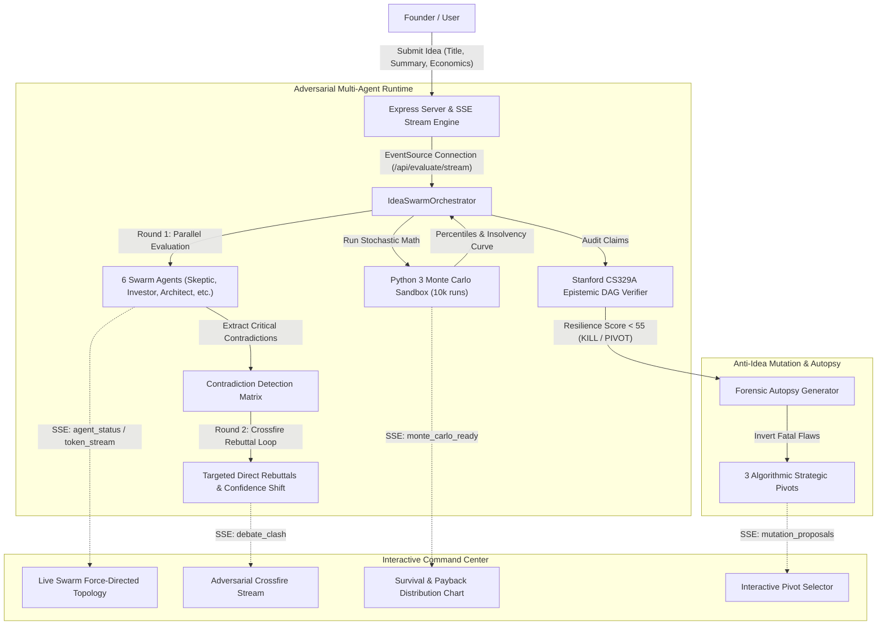

# Dossier Engineering Plan: From Good to Exceptional

This implementation blueprint details the exact technical milestones, architectural contracts, and file-by-file modifications required to transform **Dossier** from a static evaluation dashboard into an exceptional, real-time adversarial intelligence platform.

---

## 1. Architectural Blueprint & Target Flow



---

## 2. Phase Breakdown & File-by-File Workplan

### Phase 1: Engine Hardening & Streaming Infrastructure (Days 1–3)

#### Goal:
Eliminate identical scoring heuristics, introduce genuine score variance (allowing terrible ideas to ruthlessly fail), and establish Server-Sent Events (SSE) streaming so evaluations unfold in real-time.

#### 1.1 Score Variance & Hardened Prompts
* **Files:** [`src/config/prompts.ts`](file:///home/sanjeev/projects/products/dossier/src/config/prompts.ts) & [`src/core/swarm.ts`](file:///home/sanjeev/projects/products/dossier/src/core/swarm.ts)
* **Changes:**
  - Update system prompts for the **Skeptic** and **Investor** to enforce strict adversarial penalties: non-differentiated wrapper ideas or high-churn models must receive scores $< 40$.
  - Replace the static template fallback (`Unproven commitment: ...`) with domain-tailored failure patterns categorized into 8 distinct failure modes (e.g. *Cold-Start Data Poverty, Incumbent Platform Feature Replication, Regulatory Approval Chasm*).
  - Enforce strict JSON output parsing with Zod schema validation to prevent malformed LLM responses.

#### 1.2 Server-Sent Events (SSE) Endpoint
* **File:** [`src/server.ts`](file:///home/sanjeev/projects/products/dossier/src/server.ts)
* **Contract:** `POST /api/evaluate/stream`
  ```typescript
  // Event stream types:
  type SSEEvent = 
    | { type: "agent_start"; role: SwarmRole; label: string }
    | { type: "agent_chunk"; role: SwarmRole; chunk: string }
    | { type: "agent_complete"; role: SwarmRole; opinion: AgentOpinion }
    | { type: "crossfire_start"; agentA: SwarmRole; agentB: SwarmRole; topic: string }
    | { type: "crossfire_rebuttal"; agent: SwarmRole; argument: string; confidenceDelta: number }
    | { type: "sandbox_simulating"; iterationCount: number }
    | { type: "sandbox_complete"; metrics: MonteCarloResult }
    | { type: "dossier_final"; dossier: IdeaDossier };
  ```
* **Implementation:** Use `res.setHeader('Content-Type', 'text/event-stream')`, `res.setHeader('Cache-Control', 'no-cache')`, and `res.flushHeaders()` to push incremental execution stages.

---

### Phase 2: Computational Depth & Multi-Turn Crossfire (Days 4–7)

#### Goal:
Replace high-school algebra with stochastic financial modeling and implement true 2-round agent cross-examination.

#### 2.1 Python Monte Carlo Stochastic Sandbox
* **File:** [`src/tools/sandbox.ts`](file:///home/sanjeev/projects/products/dossier/src/tools/sandbox.ts)
* **New Script:** `scripts/simulate_monte_carlo.py`
  - Accept parameters: `pricing_monthly`, `churn_mean`, `churn_std`, `cac_mean`, `cac_std`, `token_cost_per_user`, `gross_margin_target`.
  - Execute 10,000 iterations using vectorized NumPy calculations.
  - Return:
    - Survival Probability (Probability cash balance $> 0$ at Month 12 & Month 24)
    - P10, P50, P90 LTV/CAC ratios and Payback Periods (in months)
    - Token Cost Burden: Percent of gross revenue consumed by inference API tokens across user percentiles
    - Sensitivity Rankings (Tornado diagram data: which variable introduces maximum volatility)

#### 2.2 Two-Round Adversarial Crossfire & Dynamic Tool Autonomy (ReAct Loop)
* **File:** [`src/core/swarm.ts`](file:///home/sanjeev/projects/products/dossier/src/core/swarm.ts)
* **Logic:**
  - **Round 1 (Parallel Inference):** Agents output initial verdicts, tag their most controversial assumption, and register any missing empirical data.
  - **Dynamic ReAct Tool Execution:** If an agent flags an unproven metric (e.g. *"Claimed B2B CAC of $40 is dubious"* or *"Model latency exceeds SLA"*), the agent autonomously triggers a tool call:
    - `run_sandbox_economics(stress_params)`: Stresses financial limits under pessimistic churn/CAC.
    - `search_competitor_recon(keyword)`: Dynamically probes real-world competitive pricing and alternatives.
  - **Conflict Identification:** Orchestrator matches the highest-scoring agent against the lowest-scoring agent (e.g. Investor @ 85 vs. Skeptic @ 35).
  - **Round 2 (Cross-Examination Turn):** Skeptic issues a direct 100-word cross-examination prompt to the Investor citing the dynamic tool findings. The Investor must either produce defensive evidence or deduct confidence points (e.g. score adjusted from 85 $\rightarrow$ 62).
  - Contradiction resolution is appended to `IdeaDossier.contradictions` with full debate history and tool execution traces.

#### 2.3 Epistemic DAG & Claim Lineage
* **Files:** [`src/core/verifier.ts`](file:///home/sanjeev/projects/products/dossier/src/core/verifier.ts) & [`src/types/index.ts`](file:///home/sanjeev/projects/products/dossier/src/types/index.ts)
* **Enhancement:**
  - Structure claims as a Directed Acyclic Graph (`ClaimNode { id, claim, tier, dependencies: string[], status }`).
  - If a root `MODELLED_ASSUMPTION` is contradicted or flagged as high risk, all dependent downstream claims automatically transition to `CONTRADICTED` or `UNKNOWN`.

---

### Phase 3: The Wow Factor & Interactive UI (Days 8–11)

#### Goal:
Elevate [`public/index.html`](file:///home/sanjeev/projects/products/dossier/public/index.html) into a command-center terminal that captivates anyone watching a live demo.

#### 3.1 Live Swarm Canvas / Active Topology
* **File:** [`public/index.html`](file:///home/sanjeev/projects/products/dossier/public/index.html)
* **Features:**
  - Replace static SVG with an interactive, animated swarm diagram.
  - Nodes highlight and pulse when an agent is computing.
  - Laser/particle animation arcs travel between agent nodes during Round 2 Crossfire to visually represent debate friction.
  - Live Confidence Dials update on each node in real-time.

#### 3.2 Visual Monte Carlo & Survival Graph
* **File:** [`public/index.html`](file:///home/sanjeev/projects/products/dossier/public/index.html)
* **Features:**
  - Render a responsive HTML5 Canvas or SVG chart displaying:
    - Probability of Survival curve over 24 months
    - Payback bell curve (P10 / P50 / P90 markers)
    - Sensitivity Bar Chart (Tornado diagram)

#### 3.3 The Idea Autopsy & Mutation Engine
* **File:** `src/core/mutator.ts` (New)
* **Features:**
  - When Resilience Score $< 55$, trigger the Mutation Engine.
  - Output 3 Mutated Alternatives:
    1. *The Wedge Pivot:* Narrow audience by 80% to eliminate sales friction.
    2. *The Business Model Inversion:* Shift from high-churn B2C subscription to B2B annual contract or usage-based model.
    3. *The Trojan Distribution:* Shift from paid ads to open-core / programmatic SEO / API-first acquisition.
  - Provide a "Re-evaluate Pivot" button in the UI that immediately launches a new dossier on the selected mutant.

---

### Phase 4: Validation Artifacts & Synthetic Customer Lab (Days 12–14)

#### Goal:
Give the platform undeniable real-world utility by turning advice into executable assets.

#### 4.1 Synthetic Customer Discovery Lab
* **Files:** [`src/server.ts`](file:///home/sanjeev/projects/products/dossier/src/server.ts) & [`public/index.html`](file:///home/sanjeev/projects/products/dossier/public/index.html)
* **Features:**
  - In the Playground view, add a **"Pitch the Skeptical Buyer"** mode.
  - Simulates a busy VP or consumer who has zero tolerance for AI buzzwords, pushes back on pricing, and tests the founder's value proposition.

#### 4.2 1-Click Validation Kit Generator
* **File:** `src/tools/validation-kit.ts` (New)
* **Exportable Assets:**
  - Complete Markdown Dossier (.md) with embedded Mermaid charts
  - Standalone HTML Smoke-Test Landing Page with pricing table and waitlist form
  - 5 Cold Discovery Outreach Email templates with customized ICP pain points

---

## 3. Verification & Quality Gates

Every phase must pass rigorous automated testing:
1. **Unit & Harness Tests:** Run `npm test` verifying that sanitization, JSON schema parsing, and sandbox isolation pass.
2. **Adversarial Invariant Suite:** Run `npm run test:stress` to ensure prompt injection and thermodynamic physics violations are rejected with score $< 20$.
3. **Score Dispersion Benchmark:** Run `npm run benchmark` across the 10 benchmark concepts. Ensure standard deviation of scores across concepts is $\ge 18$ points (preventing clustered 80–82 scores).
4. **Latency Budget:** Full 2-round swarm debate with Monte Carlo simulation must complete in under **8.5 seconds** on live LLM or under **1.8 seconds** on heuristic fallback.

---

## 4. Work Tracking & Task Dependencies

- [x] **Phase 1: Quick Wins & Streaming Engine**
  - [x] 1.1 Remove formulaic string templates & add 8 domain failure patterns
  - [x] 1.2 Implement `/api/evaluate/stream` SSE endpoint in `src/server.ts`
  - [x] 1.3 Calibrate prompt scoring rubrics to penalize unviable models
- [x] **Phase 2: Stochastic Rigor & Adversarial Crossfire**
  - [x] 2.1 Develop vectorized Python Monte Carlo simulation in `src/tools/sandbox.ts`
  - [x] 2.2 Implement 2-round crossfire rebuttal logic in `src/core/swarm.ts`
  - [x] 2.3 Construct epistemic DAG claim hierarchy in `src/core/verifier.ts`
- [x] **Phase 3: The Wow Factor & Visual Command Center**
  - [x] 3.1 Build animated live swarm canvas with debate links in `public/index.html`
  - [x] 3.2 Add HTML5 canvas survival probability & payback distribution graphs
  - [x] 3.3 Implement `src/core/mutator.ts` for automatic 3-pivot generation on failed ideas
- [ ] **Phase 4: Customer Lab & Validation Kit**
  - [ ] 4.1 Build Synthetic Buyer Persona discovery simulator in Playground
  - [ ] 4.2 Create downloadable 1-click Validation Kit (Landing Page + Outreach templates)
  - [ ] 4.3 Run benchmark regression and verify score variance $\ge 18\sigma$
